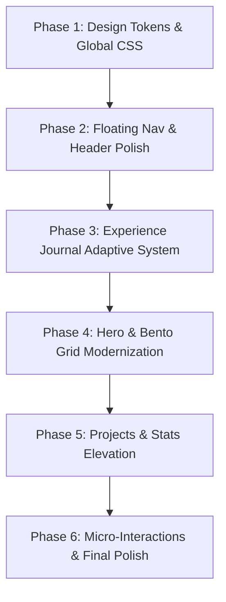

# 🎨 UI/UX & Visual Design Modernization Blueprint
**Project:** `ayush-devfolio`  
**Standard:** High-Taste Engineering Portfolio (`tasteskill 2.5` & Editorial Craft)

---

## 1. Design Vision & Philosophy

Modern developer portfolios often fall into two traps:
1. **Generic AI / Template Slop:** Identical purple mesh gradients, rainbow gradient text everywhere, generic floating cards, and repetitive infinite marquees.
2. **Unfocused Art Pieces:** Beautiful 3D gimmicks that obscure what the developer actually built and why they should be hired.

**The Goal:** Transform `ayush-devfolio` into a **Tier-1 Engineering Portfolio & Case Study System** on par with the craftsmanship of Linear, Vercel, and Stripe. It must communicate technical authority, precision, and architectural maturity in the first 3 seconds while delighting visitors with tactile, intentional interactions.

---

## 2. Core Visual Foundations

### A. Refined Midnight Obsidian Palette
Currently, the site relies on standard Tailwind CSS `hsl(217, 91%, 60%)` blues and flat dark gray cards. We elevate this to a rich, high-contrast obsidian depth:

| Token | Current Value | Proposed Modernized Value | Usage |
| :--- | :--- | :--- | :--- |
| **Canvas Background** | `222.2 47.4% 11.2%` (~#0f172a) | `#07090E` (Deep Space Obsidian) | Primary background with subtle micro-grain texture |
| **Card Surface** | `rgba(255, 255, 255, 0.04)` | `#0D111A` with 1px border `rgba(255,255,255,0.08)` | Distinct card elevation, avoids washed-out gray |
| **Primary Brand** | Purple-Blue `217.2 91.2% 59.8%` | `#6366F1` (Electric Indigo) & `#8B5CF6` (Violet) | Selective focus on primary CTAs and active states |
| **Accent / Metrics** | Sky Blue `199 89% 55%` | `#10B981` (Emerald) & `#F59E0B` (Amber) | High-contrast proof-of-work badges, ratings, live stats |
| **Muted Text** | `hsl(215 20.2% 65.1%)` | `#94A3B8` (Slate-400) with 1.625 line height | Crisp legibility without straining eyes |

### B. Typographic Hierarchy & Restraint
We strictly organize the existing fonts ([Clash Display](file:///run/media/ayush5410/Ayush/Portfolio/ayush-devfolio/public/fonts/ClashDisplay-Bold.woff2), [Inter](file:///run/media/ayush5410/Ayush/Portfolio/ayush-devfolio/src/app/layout.js), [JetBrains Mono](file:///run/media/ayush5410/Ayush/Portfolio/ayush-devfolio/public/fonts/JetBrainsMono-Regular.woff2)) into explicit roles:
1. **Editorial Headlines (`font-display`):** Reserved strictly for Section Titles and Hero Name. Negative letter spacing (`tracking-tight` / `-0.03em`) for a confident, solid feel.
2. **Metadata & Labels (`font-mono-code`):** All dates, commit counts, tags, status badges, and section indices. Sized at `11px–13px` uppercase with generous tracking (`tracking-[0.15em]`).
3. **Body & Case Study Copy (`font-sans`):** High-readability Inter with optimized line length (maximum 68 characters per line) and relaxed line height.

---

## 3. Section-by-Section Elevation Strategy

### 1. Navigation: Floating Glass Island
* **Current:** Full-width fixed banner spanning 100% width with a solid background upon scroll.
* **Modernized:**
  * Transform into a **Floating Capsule / Island** centered at the top (`max-w-4xl mx-auto top-4 inset-x-0`).
  * Frosted glass blur (`backdrop-blur-xl bg-background/70 border border-white/10 rounded-full shadow-2xl`).
  * Add a sliding active pill indicator that smoothly glides between tabs using Framer Motion `layoutId="navPill"`.
  * **Stealth Admin Cleanup:** Remove any visible "Admin" text from public navigation and footers. Keep access exclusively triggered via `Ctrl + Shift + A`.

---

### 2. Hero Section: Confident Engineering Entrance
* **Current:** Standard "Hi, I'm Ayush Tiwari" with rainbow gradient text and floating controls overlapping the profile picture.
* **Modernized:**
  * **Status Pill:** Replace generic ping dot with a live engineering telemetry badge:
    `🟢 JABALPUR, IN · AVAILABLE FOR FULL-TIME / FREELANCE · 5,600+ COMMITS`.
  * **Hero Copywriting:** Sharp, non-generic positioning:
    *"Full Stack Engineer specializing in distributed web systems, Next.js architecture, and cloud infrastructure. Published researcher in network security (Springer)."*
  * **Solar System HUD:** Dock controls into an elegant, discreet bottom-right pill with glass aesthetics, preventing overlap with the profile image and headline.
  * **Profile Frame:** Add subtle concentric orbital rings that slowly rotate, grounding the profile photo within the cosmic theme.

---

### 3. About Section: The Architectural Bento
* **Current:** Split into separate disconnected lists (bio paragraph + stat grid + value cards).
* **Modernized:**
  * Assemble an **Architectural Bento Grid**:
    * **Tile 1 (Large):** Personal Narrative + Springer publication spotlight badge with direct DOI link.
    * **Tile 2:** Live Interactive Terminal showing recent commit activity or stack philosophy.
    * **Tile 3:** Academic & Research credentials (B.Tech CSE, Gyan Ganga).
    * **Tile 4:** Verified Industry Badges (AWS Solutions Architect & Cloud Practitioner).

---

### 4. Experience: The Executive Journal (Desktop & Mobile)
* **Current:** Fixed 1,120px spread that breaks on mobile; slightly flat paper rendering.
* **Modernized:**
  * **Desktop Luxury Polish:**
    * Add subtle paper texture background and debossed gold/emerald foil badges for engineering metrics.
    * Add realistic book spine lighting shadow (`linear-gradient(to right, rgba(0,0,0,0.6), transparent)`).
    * Smooth turn indicator with subtle micro-tilt on page hover.
  * **Mobile Adaptive Ledger:**
    * On mobile screens (<1024px), transition automatically into an **Executive Field Notes Ledger**:
      * A segmented control toggle: `[ Context & Stack ]` ⟷ `[ Technical Impact & Metrics ]`.
      * Generous spacing, large typography, zero cut-offs, zero horizontal overflow.

---

### 5. Skills: Interactive Capabilities Matrix
* **Current:** Three rows of auto-scrolling infinite marquees. While animated, marquees can feel passive and uninformative.
* **Modernized:**
  * Keep marquee as an ambient visual option, but provide a **Curated Capability Matrix**:
    * Categorized into *Core Architecture* (Next.js, Node.js, React), *Cloud & Systems* (AWS, Docker, PostgreSQL, Supabase), and *Data & Creative* (Three.js, Algorithms, System Design).
    * Each skill card shows its real colored brand icon, proficiency tier, and a list of projects in this portfolio where it was deployed.

---

### 6. Projects Showcase: Engineering Artifacts
* **Current:** Standard grid with static image card, title, text, and basic buttons.
* **Modernized:**
  * **Artifact Preview Header:** Instead of standard thumbnails, feature interactive mockups with:
    * Live badge: e.g., *"Production Deployment"*, *"Open Source"*, *"Research Backed"*.
    * Architecture Quick-View: Hovering over a card offers an instant peek at the system diagram or video preview.
    * Key Engineering Metrics: E.g., `Latency: <15ms`, `Commits: 450+`, `Architecture: Event-Driven`.

---

### 7. Competitive Programming & Coding Stats: The Terminal Deck
* **Current:** Disjointed stat cards and third-party platform badges.
* **Modernized:**
  * Style as a **Developer Command Center**:
    * Top Bar with system status: `AYUSH-CLI v2.4 // PROOF_OF_WORK.sh`.
    * Overall metrics rendered with monospace digit alignment and fluid count-up animations.
    * Platform cards (LeetCode 1657, CodeChef 1443, Codeforces) styled with subtle platform-colored neon rims and live profile jump links.

---

### 8. Contact & Footer Polish
* **Modernized:**
  * **Contact Section:** Transform the standard form into a streamlined, high-trust conversation starter with pre-filled topic pills (*"Build a Full-Stack System"*, *"Freelance Project"*, *"Tech Consultation"*).
  * **Footer:**
    * Remove the visible `Admin Panel →` and `Admin Login` links (relying exclusively on the `Ctrl + Shift + A` stealth trigger).
    * Add live local time indicator (`🕒 Jabalpur, India (IST, UTC+5:30)`).
    * Keep minimal copyright and social pill links.

---

## 4. Prioritized Execution Plan

1. **Step 1 (Tokens & Foundation):** Refine colors in `globals.css` and `tailwind.config.js` to eliminate washed-out slate and establish obsidian depth.
2. **Step 2 (Navigation):** Upgrade `Navbar.js` to the floating frosted glass capsule with active tab animations.
3. **Step 3 (Experience & Responsiveness):** Build the adaptive mobile ledger fallback for `Experience.js` and polish the desktop 3D book spread.
4. **Step 4 (Hero & About Bento):** Relocate HUD controls, add live status pills, and convert About into an architectural bento grid.
5. **Step 5 (Project Artifacts & Terminal Stats):** Add live metric tags, architecture previews, and terminal styling to competitive programming stats.
6. **Step 6 (Footer & Final Polish):** Clean up admin links in footer and fine-tune all hover micro-interactions.
