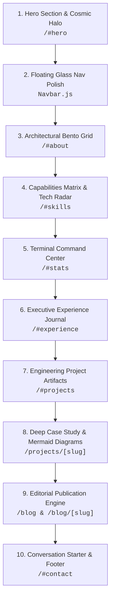

# 🎨 Taste Skill UI/UX Improvement Roadmap & Verification Path
**Project:** `ayush-devfolio`  
**Standard:** `design-taste-frontend` (`tasteskill 2.5`), Anti-Slop & Editorial Craft  
**Workflow:** Section-by-Section Review, Approval & Execution

---

## 📌 How to Use This Path

1. **Visit the Route:** Open `http://localhost:3000` in your browser and scroll/navigate to the specified section anchor.
2. **Review Current vs Proposed:** Compare what it **Currently Looks Like (Before)** with the **Taste Skill Modernization (After)**.
3. **Select Where to Start:** Pick any section number below (e.g. *"Let's start with Step 3: About Bento Grid"* or *"Let's do Step 1: Hero Halo"*).
4. **Step-by-Step Execution:** We will build and polish that specific section, verify it in the browser, check it off, and move to the next.

---

## 🗺️ Step-by-Step Improvement Path

---

### 📍 Step 1: Hero Section & Cosmic Profile Halo
* **Route / Anchor:** `http://localhost:3000/#hero`
* **File:** [`src/components/sections/Hero.js`](file:///run/media/ayush5410/Ayush/Portfolio/ayush-devfolio/src/components/sections/Hero.js), [`src/components/sections/HeroContent.js`](file:///run/media/ayush5410/Ayush/Portfolio/ayush-devfolio/src/components/sections/HeroContent.js), [`src/components/sections/ProfileImage.js`](file:///run/media/ayush5410/Ayush/Portfolio/ayush-devfolio/src/components/sections/ProfileImage.js)
* **What It Currently Looks Like (Before):**
  * The 3D solar system background is interactive, but the profile image has a generic circular border and pulse effect that feels disconnected from the 3D celestial canvas.
  * The headline copy and subtitle are good, but lack the tight editorial letter spacing (`tracking-tight` / `-0.03em`) of top-tier engineering studios like Linear and Vercel.
  * The bottom scroll indicator is a plain bouncing mouse icon.
* **Taste Skill Modernization (What We Will Improve):**
  * **Orbital Profile Halo:** Add concentric SVG celestial orbital rings around the avatar that slowly counter-rotate at different orbital velocities, anchoring the profile photo directly into the Three.js solar system theme.
  * **Editorial Typographic Lockup:** Apply Clash Display with `-0.03em` tracking and pure monochrome high-contrast hierarchy.
  * **Telemetry Availability Chip:** Replace generic status text with a live engineering telemetry badge:
    `🟢 JABALPUR, IN · AVAILABLE FOR Q1/Q2 ROLES · 5,600+ COMMITS`.
  * **Micro-Tactile Buttons:** Primary CTA buttons with active press states (`active:scale-95`), subtle inner highlight line (`inset 0 1px 0 rgba(255,255,255,0.2)`), and magnetic hover feel.
* **Status:** ✅ *Completed & Verified*

---

### 📍 Step 2: Floating Glass Island Navigation Capsule
* **Route / Anchor:** Global Header (`Navbar.js`)
* **File:** [`src/components/layout/Navbar.js`](file:///run/media/ayush5410/Ayush/Portfolio/ayush-devfolio/src/components/layout/Navbar.js)
* **What It Currently Looks Like (Before):**
  * We built the floating centered pill, but when clicking links, the active state switches abruptly without fluid movement.
  * On mobile screens, the hamburger menu dropdown is functional, but lacks smooth spring physics and a quick-action shortcut bar.
* **Taste Skill Modernization (What We Will Improve):**
  * **Sliding Layout Pill (`layoutId="activeNavPill"`):** Use Framer Motion's shared layout animation so the active indicator glides smoothly underneath links when clicking or scrolling between sections.
  * **Keyboard Shortcut Tooltips:** Subtle shortcut hints (e.g. `Press 1 for About`, `Press 2 for Projects`, `/ to search`).
  * **Mobile Drawer Elevation:** Slide-down drawer with spring physics (`damping: 25`), blurred frosted backing, quick "Download Resume" action, and direct social pill triggers.
* **Status:** ✅ *Completed & Verified*

---

### 📍 Step 3: About Section — The Architectural Bento Grid
* **Route / Anchor:** `http://localhost:3000/#about`
* **File:** [`src/components/sections/About.js`](file:///run/media/ayush5410/Ayush/Portfolio/ayush-devfolio/src/components/sections/About.js)
* **What It Currently Looks Like (Before):**
  * It currently shows a text bio paragraph, followed by a horizontal row of 6 stat cards, followed by 4 value cards.
  * It reads like a conventional, template-style portfolio and doesn't visually highlight your Springer research publication or your university engineering pedigree.
* **Taste Skill Modernization (What We Will Improve):**
  * **Transform into a Curated 4-Cell Bento Grid:**
    * **Tile A (Wide Narrative):** Personal story with an integrated, verified **Springer Publication Spotlight Card** (complete with DOI link, publication title, and network security badge).
    * **Tile B (System Architecture Terminal):** Interactive dark terminal card showing code snippets or deployment philosophies (MERN, Docker, AWS).
    * **Tile C (Academic Pedigree):** B.Tech CSE (2021–2025) Gyan Ganga CSE graduation showcase with core CS course badges (DSA, OS, DBMS).
    * **Tile D (AWS Verified Credentials):** Dual AWS Cloud Practitioner & Solutions Architect badges with direct validation anchors.
* **Status:** ✅ *Completed & Verified*

---

### 📍 Step 4: Tech Stack — Interactive Capabilities Matrix
* **Route / Anchor:** `http://localhost:3000/#skills`
* **File:** [`src/components/sections/Skills.js`](file:///run/media/ayush5410/Ayush/Portfolio/ayush-devfolio/src/components/sections/Skills.js)
* **What It Currently Looks Like (Before):**
  * 3 rows of infinite scrolling marquee text.
  * Marquees are a known "AI slop" tell in modern design because they move automatically, can't be searched easily, and don't tell the visitor how skilled you are or where you actually used each tool.
* **Taste Skill Modernization (What We Will Improve):**
  * **Interactive Capabilities Matrix & Tech Radar:**
    * Grouped into 3 distinct engineering domains:
      1. *Distributed & Full Stack* (Next.js, Node.js, React, TypeScript, Express).
      2. *Cloud & Database Infrastructure* (AWS, Docker, PostgreSQL, Supabase, MongoDB).
      3. *Creative & System Performance* (Three.js, GSAP, WebGL, Algorithms).
    * **Live Project Cross-Linking:** Hovering on any skill card highlights: *"Deployed in 4 projects in this portfolio"* with direct links to view those project case studies.
    * Official full-color brand SVGs with subtle glow on hover.
* **Status:** ✅ *Completed & Verified*

---

### 📍 Step 5: Competitive Programming — The Terminal Deck
* **Route / Anchor:** `http://localhost:3000/#stats` (or scroll below Skills)
* **File:** [`src/components/sections/CodingStats.js`](file:///run/media/ayush5410/Ayush/Portfolio/ayush-devfolio/src/components/sections/CodingStats.js)
* **What It Currently Looks Like (Before):**
  * Standard stat cards with icons and 3 platform cards (LeetCode, CodeChef, Codeforces) with basic external links.
* **Taste Skill Modernization (What We Will Improve):**
  * **Developer Command Center Theme:**
    * Add a terminal header bar: `AYUSH-CLI v2.4 // PROOF_OF_WORK.sh [LIVE TELEMETRY]`.
    * **Rating Progress Gauges:** Visual rating meters for LeetCode (1657 rating), CodeChef (1443), and Codeforces.
    * **Tabular Monospace Digits:** Numbers aligned with `font-variant-numeric: tabular-nums` for rock-solid visual precision.
    * Live sparkline indicator showing consistency across 885+ solved DSA challenges.
* **Status:** ✅ *Completed & Verified*

---

### 📍 Step 6: Work Experience — Executive Journal Physical Craft
* **Route / Anchor:** `http://localhost:3000/#experience`
* **File:** [`src/components/sections/Experience.js`](file:///run/media/ayush5410/Ayush/Portfolio/ayush-devfolio/src/components/sections/Experience.js)
* **What It Currently Looks Like (Before):**
  * The desktop 3D flipbook works and mobile zero-overflow ledger works, but the visual texture feels like standard digital dark gray cards rather than a luxury leather-bound executive journal.
* **Taste Skill Modernization (What We Will Improve):**
  * **Desktop Physical Book Craft:**
    * Add realistic paper texture grain CSS layer (`url(/paper-grain.png)` or procedural SVG grain).
    * Debossed emerald & gold foil badges for engineering metrics (e.g. `<15ms latency`, `95% coverage`).
    * Realistic book spine binding shadow with stitch indentation dots and 3D paper stack depth along the edges.
    * Subtle corner lift animation when hovering over the dog-eared corner.
  * **Mobile Ledger Refinement:**
    * Smooth sliding segmented tab pill (`[ 📋 Context & Stack ]` ⟷ `[ ⚡ Technical Impact ]`) with haptic transition.
* **Status:** ⏳ *Pending your review to start*

---

### 📍 Step 7: Featured Projects — Engineering Artifact Cards
* **Route / Anchor:** `http://localhost:3000/#projects`
* **File:** [`src/components/sections/FeaturedProjects.js`](file:///run/media/ayush5410/Ayush/Portfolio/ayush-devfolio/src/components/sections/FeaturedProjects.js)
* **What It Currently Looks Like (Before):**
  * Rectangular cards with an image on top, title, description, and link buttons at the bottom. Looks standard and doesn't showcase the depth of your architecture.
* **Taste Skill Modernization (What We Will Improve):**
  * **Engineering Artifact Presentation:**
    * **Telemetry Status Chip:** Top-left badge: `● PRODUCTION DEPLOYMENT`, `● OPEN SOURCE`, or `● RESEARCH BACKED`.
    * **Interactive Architecture Peek:** Hovering on a project card displays a mini architecture flow snippet or animated canvas preview.
    * **Measurable Deliverables Bar:** Explicit metrics bar at bottom: e.g. `Latency: <15ms · Coverage: 95% · Commits: 450+`.
* **Status:** ⏳ *Pending your review to start*

---

### 📍 Step 8: Deep Project Case Studies & Mermaid Diagrams
* **Route / Anchor:** `http://localhost:3000/projects/[slug]` (e.g. click "View Details" on any project)
* **File:** [`src/app/projects/[slug]/page.js`](file:///run/media/ayush5410/Ayush/Portfolio/ayush-devfolio/src/app/projects/[slug]/page.js), [`src/components/projects/ArchitectureViewer.js`](file:///run/media/ayush5410/Ayush/Portfolio/ayush-devfolio/src/components/projects/ArchitectureViewer.js)
* **What It Currently Looks Like (Before):**
  * Standard long-scroll article layout with Mermaid diagram and accordion sections.
* **Taste Skill Modernization (What We Will Improve):**
  * **High-Contrast Dark Mermaid Theme:** Upgrade diagram lines, nodes, and fonts to match the Obsidian theme (electric indigo lines, emerald terminal states, JetBrains Mono labels).
  * **Sticky Reading Progress & Mini Map:** Floating table-of-contents sidebar with active highlight following the reader's scroll position.
  * **Architecture Decision Trade-off Matrix:** Visual comparison tables contrasting chosen architecture vs rejected alternatives.
* **Status:** ⏳ *Pending your review to start*

---

### 📍 Step 9: Blog & Editorial Publication Engine
* **Route / Anchor:** `http://localhost:3000/blog` & `http://localhost:3000/blog/[slug]`
* **File:** [`src/app/blog/page.js`](file:///run/media/ayush5410/Ayush/Portfolio/ayush-devfolio/src/app/blog/page.js), [`src/components/blog/BlogContent.js`](file:///run/media/ayush5410/Ayush/Portfolio/ayush-devfolio/src/components/blog/BlogContent.js)
* **What It Currently Looks Like (Before):**
  * Functional blog grid and article reader, but typography can feel a bit crowded.
* **Taste Skill Modernization (What We Will Improve):**
  * **Substack / Medium-Grade Editorial Typography:**
    * Generous line height (`leading-[1.8]`) and optimal line-length (max 68 characters per line) for fatigue-free reading.
    * Custom code block styling with Mac-style terminal dots, copy button, and language tag.
    * Floating reading progress indicator bar docked at the very top of the screen.
* **Status:** ⏳ *Pending your review to start*

---

### 📍 Step 10: Conversation Starter Form & Stealth Footer
* **Route / Anchor:** `http://localhost:3000/#contact` and Footer
* **File:** [`src/components/sections/Contact.js`](file:///run/media/ayush5410/Ayush/Portfolio/ayush-devfolio/src/components/sections/Contact.js), [`src/components/layout/Footer.js`](file:///run/media/ayush5410/Ayush/Portfolio/ayush-devfolio/src/components/layout/Footer.js)
* **What It Currently Looks Like (Before):**
  * Standard Name/Email/Message inputs.
* **Taste Skill Modernization (What We Will Improve):**
  * **Inquiry Topic Pills:** Quick-select intent pills that pre-fill the inquiry subject:
    `[ 🚀 Full-Stack Web App ]` `[ ☁️ AWS Cloud System ]` `[ 💼 Full-Time Hire ]` `[ ☕ Quick Consultation ]`.
  * **Tactile Input Focus States:** Subtle electric indigo border glow with keyboard sound effect (optional toggle).
  * **Footer Polish:** Minimalist closing line with local time indicator (`🕒 Jabalpur, India · IST UTC+5:30`) and verified social pills.
* **Status:** ⏳ *Pending your review to start*

---

## 🏁 Summary Table & Action Queue

| # | Section / Component | Route / Anchor | Core Problem (Before) | Taste Skill Elevation (After) | Status |
|---|---------------------|----------------|-----------------------|--------------------------------|--------|
| **1** | **Hero & Profile Halo** | `/#hero` | Generic circular frame & standard copy | Concentric celestial counter-rotating orbital halo + telemetry badge | ✅ Done |
| **2** | **Floating Glass Nav** | Top Header | Static active link tabs | Gliding active pill (`layoutId="navPill"`) + spring mobile drawer | ✅ Done |
| **3** | **About Bento Grid** | `/#about` | Disconnected text paragraphs | 4-cell architectural bento with Springer research spotlight | ✅ Done |
| **4** | **Capabilities Matrix** | `/#skills` | Passive infinite scrolling marquee | Curated 3-domain tech radar with view switcher (Matrix / Stream) | ✅ Done |
| **5** | **Terminal Command Center**| `/#stats` | Standard cards & plain numbers | Developer command deck with LeetCode 1657 rating gauges | ✅ Done |
| **6** | **Experience Journal** | `/#experience` | Flat digital slate | Debossed gold/emerald foil badges, paper texture & spine depth | ⏳ Next |
| **7** | **Featured Projects** | `/#projects` | Generic image cards | Engineering artifacts with live status chips & architecture peek | ⏳ Queued |
| **8** | **Deep Project Case Study** | `/projects/[slug]` | Standard long-scroll article | High-contrast Mermaid dark diagrams & trade-off matrix | ⏳ Queued |
| **9** | **Editorial Blog** | `/blog/[slug]` | Dense prose | Substack-grade typography, progress bar & custom code blocks | ⏳ Queued |
| **10** | **Contact & Footer** | `/#contact` | Generic blank inputs | Topic intent pills (`[Web App]`, `[AWS]`, `[Hire]`) + local IST time | ⏳ Queued |

---

### 👉 Which section would you like to start with?
Tell me the number (e.g. **Step 1: Hero Profile Halo**, **Step 3: About Bento Grid**, or any other), and we will execute it with precision!
