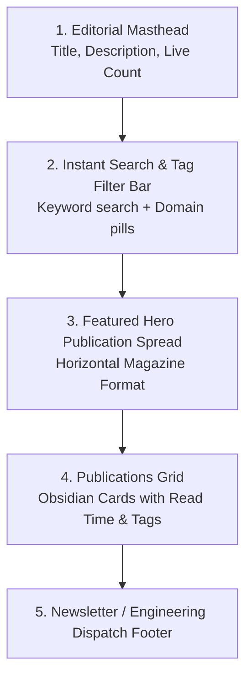
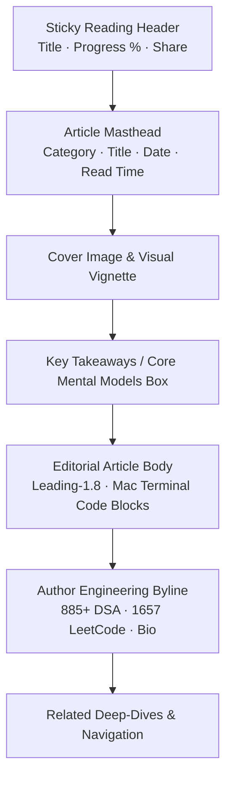

# 📚 Blog & Editorial Reading Experience Modernization Plan

**Project:** `ayush-devfolio`  
**Target Routes:**  
1. `http://localhost:3000/blog` (The Publications Catalog & Search Hub)  
2. `http://localhost:3000/blog/stop-forgetting-dsa-problems` (The Long-Form Article Reading Experience)  
**Standard:** `design-taste-frontend` (`tasteskill 2.5`), Substack / Stripe / Vercel Engineering Blog Editorial Craft  
**Goal:** Remove generic "AI vibe coding" tells, implement world-class editorial typography and layout rhythm, and add high-utility reading amenities that make deep-dives genuinely engaging and readable.

---

## 🎯 1. Diagnosis: AI "Vibe Coding" Tells vs High-Craft Editorial Design

| Area | Current "AI Vibe Coding" Tell (Before) | High-Craft Editorial Standard (After) |
| :--- | :--- | :--- |
| **Theme Alignment** | Uses disconnected `bg-card` and standard gray borders (`border-border`) that feel separate from the Deep Space Obsidian theme. | Seamless `#05070B` Deep Space Obsidian background with `#090D16` surfaces, hairline borders (`border-white/10`), and subtle ambient glow. |
| **Catalog Header** | Generic `Articles & Deep-dives` headline with a floating PenLine icon and standard gradient text. | Editorial masthead: `// AYUSH TIWARI // PUBLICATIONS & FIELD NOTES`, Clash Display typographic lockup, live article counter, and instant keyword search. |
| **Catalog Cards** | Basic 2-column cards with generic yellow "Featured" star badge, heavy gradient overlays, and plain "No cover" placeholders. | Magazine-grade horizontal featured showcase + unified obsidian cards with live read-time chips, topic tags, and micro-hover interactions. |
| **Reading Header** | Standard `← Back to Blog` link, plain icons with small text, and an uninspiring layout. | Clean back navigation pill, article category breadcrumb, reading time estimate, published date, and an **Executive Masthead** with verified author telemetry. |
| **Reading Measure & Flow** | Article body is either too wide or inconsistent; paragraph spacing feels crowded; line-height is standard web text (`leading-relaxed`). | **Optimal Reading Measure:** Constrained to `max-w-[720px]` (65–75 characters per line) with `leading-[1.8]`, comfortable paragraph rhythm, and typographic scale. |
| **Code Blocks** | Default syntax highlighter block with basic borders and standard syntax styling. | **Mac Terminal Chrome:** 3 traffic light dots (🔴 🟡 🟢), language badge (e.g. `C++ // TWO_POINTERS.cpp`), one-click copy button with tactile checkmark, and custom obsidian syntax theme. |
| **Sticky Progress Amenity** | Thin 3px line at top of viewport that is easy to miss when scrolling. | **Sticky Reading Telemetry Bar:** Slides down as the user scrolls past the title, showing the article title in monospace, live scroll % gauge, and quick-share triggers. |
| **Table of Contents** | Generic box with standard link highlights. | **High-Precision Scroll-Spy TOC:** Sticky sidebar with active heading pill, scroll percentage, and smooth jump anchors. |
| **Key Takeaways Box** | Greenish gradient box with basic checkmarks. | **Architectural Blueprint Callout:** `✦ CORE MENTAL MODELS & TL;DR` with emerald accent borders and numbered actionable takeaways. |
| **Author Credibility** | Missing author signature; reads like an anonymous generic internet article. | **Author Proof-of-Work Byline:** Ayush Tiwari avatar, engineering proof metrics (`885+ DSA Solved`, `LeetCode 1657`, `5,600+ GitHub Commits`), and direct links to connect or discuss. |

---

## 🗺️ 2. Route 1 Architecture: `http://localhost:3000/blog`

### Key Enhancements to Build:
1. **Interactive Editorial Masthead & Search:**
   - Pre-title: `// 05. TECHNICAL PUBLICATIONS & FIELD NOTES`
   - Headline: `Engineering Notes, Deep-Dives & System Design`
   - Real-time search bar: Search articles by keyword, topic, or title with instant client-side filtering and zero layout shift.
   - Filter pills: `[ All ]` `[ DSA & Algorithms ]` `[ Next.js & Full-Stack ]` `[ Cloud & AWS ]` `[ Security ]`.
2. **Featured Article Showcase:**
   - Asymmetric horizontal magazine card for the featured article (e.g. *Stop Forgetting DSA Problems*).
   - Crisp cover image preview with subtle hover zoom (`scale-[1.02]`), live read-time badge (`● 8 MIN READ`), and publication date.
3. **Obsidian Card Grid:**
   - Clean 2-column grid of obsidian cards (`#090D16`) with hairline borders (`border-white/10`).
   - Monospace metadata row and tags.

---

## 🗺️ 3. Route 2 Architecture: `http://localhost:3000/blog/[slug]`
*(e.g. `http://localhost:3000/blog/stop-forgetting-dsa-problems`)*

### The 7 Essential Reading Amenities:

### 1. Sticky Editorial Reading Progress Header
- Docked at the top of the browser viewport once the user scrolls past the main title.
- Contains:
  - Back to Blog arrow link (`← Blog`).
  - Current article title truncated in monospace: `STOP FORGETTING DSA PROBLEMS`.
  - Real-time percentage indicator and gauge bar: `● 45% COMPLETED`.
  - Quick share buttons (Copy Link, Twitter/X, LinkedIn).

### 2. Substack / Medium-Grade Editorial Typography
- **Reading Measure:** Article content container capped at `max-w-[720px]` to maintain the golden 65–75 characters per line rule (preventing wide screen eye fatigue).
- **Type Hierarchy:**
  - `H1`: Clash Display `text-3xl sm:text-5xl font-bold tracking-tight text-white leading-[1.15]`.
  - `H2`: `text-2xl sm:text-3xl font-bold text-white tracking-tight mt-14 mb-5 border-b border-white/10 pb-3`.
  - `H3`: `text-xl sm:text-2xl font-bold text-indigo-300 mt-10 mb-4`.
  - Body text: `text-[17px] sm:text-[18px] text-gray-300 leading-[1.8] font-sans mb-7 antialiased`.
  - Inline code: `px-1.5 py-0.5 rounded-md bg-white/[0.06] border border-white/10 font-mono-code text-indigo-300 text-[0.9em]`.

### 3. Mac Terminal Code Blocks Chrome
- Every code block (in `BlogContent.js`) wrapped in a developer terminal frame:
  - Top titlebar with 3 dots: 🔴 🟡 🟢
  - Monospace filename or language indicator (e.g. `C++ // SPACING_REPETITION_TEMPLATE.cpp`)
  - One-click copy button with tactile "Copied!" feedback and checkmark icon.
  - Background `#080B12` with syntax highlighting using `oneDark` theme.

### 4. Architectural "Core Mental Models" Callout (TL;DR Box)
- Before the dense prose begins, an executive blueprint box summarizing the core concepts:
  - Header: `✦ EXECUTIVE SUMMARY & CORE MENTAL MODELS`
  - 3–4 numbered actionable principles (e.g. `01: Pattern Categorization over Memorization`, `02: Spaced Repetition Intervals`, `03: Active Recall via Whiteboarding`).

### 5. High-Precision Scroll-Spy Table of Contents
- Positioned in the sticky right sidebar (`xl:w-72`).
- Automatically watches all `<h2>` and `<h3>` tags via `IntersectionObserver`.
- Active heading highlighted with an electric indigo pill and dot indicator.

### 6. Author Engineering Credibility Byline
- At the conclusion of the article:
  - Ayush Tiwari avatar with verified badge.
  - Authentic credentials: *"Written by Ayush Tiwari — Full Stack Systems Engineer with 885+ DSA problems solved across LeetCode (rating 1657), CodeChef, and Codeforces. Published researcher in network security (Springer) with 5,600+ GitHub commits."*
  - Direct connection links: Connect on LinkedIn, follow on Twitter/X, view GitHub.

### 7. Related Articles & Discussion CTA
- Contextually relevant related deep-dives at the bottom so readers can continue exploring.
- Minimalist feedback/share strip.

---

## 🛠️ 4. Files to Touch & Modernize

1. [`src/app/blog/page.js`](file:///run/media/ayush5410/Ayush/Portfolio/ayush-devfolio/src/app/blog/page.js): Modernize hero masthead, SEO metadata, and Deep Space Obsidian theme.
2. [`src/components/blog/BlogFilterClient.js`](file:///run/media/ayush5410/Ayush/Portfolio/ayush-devfolio/src/components/blog/BlogFilterClient.js): Implement real-time keyword search, domain filter tabs, magazine-style featured hero card, and obsidian post cards.
3. [`src/app/blog/[slug]/page.js`](file:///run/media/ayush5410/Ayush/Portfolio/ayush-devfolio/src/app/blog/[slug]/page.js): Implement sticky reading progress header, editorial masthead, reading time, author byline, and next articles grid.
4. [`src/components/blog/BlogContent.js`](file:///run/media/ayush5410/Ayush/Portfolio/ayush-devfolio/src/components/blog/BlogContent.js): Upgrade editorial prose typography (`leading-[1.8]`, `text-[18px]`), Mac terminal code block chrome, and callout styling.
5. [`src/components/blog/BlogSidebar.js`](file:///run/media/ayush5410/Ayush/Portfolio/ayush-devfolio/src/components/blog/BlogSidebar.js): Upgrade scroll-spy TOC with active pill animations and obsidian surface.
6. [`src/components/blog/BlogTakeaways.js`](file:///run/media/ayush5410/Ayush/Portfolio/ayush-devfolio/src/components/blog/BlogTakeaways.js): Upgrade to the architectural "Core Mental Models" callout format.

---

## 🏁 5. Step-by-Step Execution Order

| Step | Component / Route | What We Will Build |
|---|---|---|
| **Step 1** | **Blog Index Hero & Search** (`/blog`) | Masthead + instant search bar + domain filter pills + Deep Space Obsidian theme |
| **Step 2** | **Blog Index Magazine Cards** (`/blog`) | Featured hero publication card + 2-col obsidian article cards with read-time badges |
| **Step 3** | **Sticky Reading Progress Header** (`/blog/[slug]`) | Top bar with title, live % read gauge, back link, and share triggers |
| **Step 4** | **Editorial Reading Typography & Spacing** (`BlogContent.js`) | Medium/Substack-grade `max-w-[720px]` container, `leading-[1.8]`, 18px body font |
| **Step 5** | **Mac Terminal Code Chrome** (`BlogContent.js`) | Terminal titlebar (🔴 🟡 🟢), language badge, tactile copy button, obsidian syntax |
| **Step 6** | **Core Mental Models Box** (`BlogTakeaways.js`) | Architectural blueprint callout with numbered insights |
| **Step 7** | **Interactive Scroll-Spy TOC** (`BlogSidebar.js`) | Obsidian card with animated active indicator and reading telemetry |
| **Step 8** | **Author Engineering Byline & Footer** (`/blog/[slug]`) | Author signature card with DSA credentials (885+ solved, 1657 rating) + related reads |
