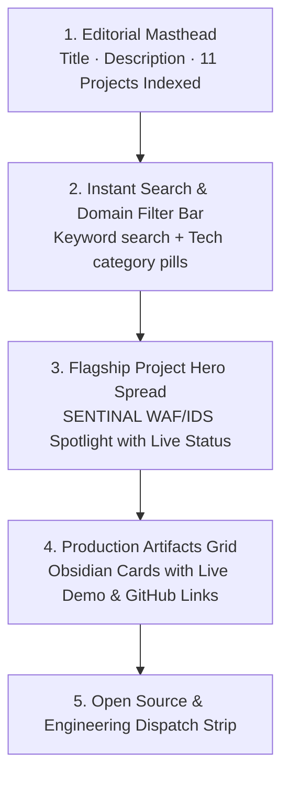
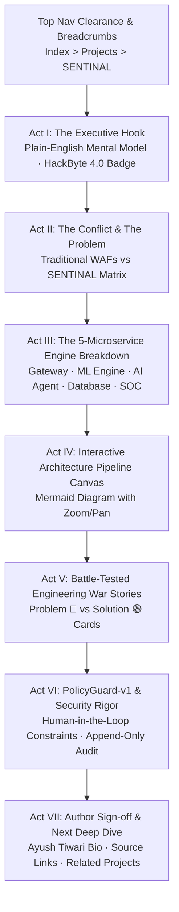

# 🚀 Projects Catalog & Storytelling Case Study Modernization Plan

**Project:** `ayush-devfolio`  
**Target Routes:**  
1. `http://localhost:3000/projects` (The Engineering Artifacts Catalog Hub)  
2. `http://localhost:3000/projects/sentinal` (The Narrative Storytelling Case Study)  
**Standard:** `design-taste-frontend` (`tasteskill 2.5`), Stripe Press & Linear Case Study Narrative Craft  
**Goal:** Transform the raw technical documentation into an engaging, human-comprehensible story that anyone (recruiters, engineers, investors, and founders) can easily understand and be captivated by, while establishing deep engineering authority.

---

## 🎯 1. Diagnosis: Generic Portfolio Tells vs High-Craft Storytelling

| Area | Generic "Vibe Coding" Tell (Before) | High-Craft Storytelling Standard (After) |
| :--- | :--- | :--- |
| **Catalog Hero** | Center-aligned `My Projects` with generic purple gradient text and standard subtitle. | Editorial Engineering Masthead: `// 02. PRODUCTION ARTIFACTS & CASE STUDIES`, Clash Display typographic lockup, live project count badge (`11 PROJECTS ARCHIVED`), and instant keyword/stack search. |
| **Catalog Filtering** | Static list without real-time filtering, search, or domain categorization. | **Instant Filter Hub:** Real-time search across titles, descriptions, and technologies + domain pills (`Cybersecurity & WAF`, `Full-Stack Platforms`, `AI & Real-Time`, `Game Engines`). |
| **Flagship Showcase** | SENTINAL is buried as just another card in a 3-column grid. | **Flagship Asymmetric Showcase:** Dedicated spotlight card for SENTINAL with live production telemetry pill, metrics chips (5 Microservices, 36hr Build), cover preview, and primary CTA. |
| **Project Case Study Header** | Plain `All Projects` link colliding with top padding, followed by raw title and tags. | Clean top clearance (`pt-28 sm:pt-36`), breadcrumb navigation (`Index > Projects > SENTINAL`), Hackathon badge (`🏆 HackByte 4.0`), and dual live links (`Live SOC Dashboard` + `Source Code`). |
| **Story Arc / Executive Pitch** | Immediately dumps technical jargon without explaining what the system does for real people. | **Act I: The Plain-English Mental Model:** *"Think of SENTINAL as an intelligent digital border checkpoint for web apps that stops attacks in milliseconds without blocking real humans."* |
| **The Antagonist (The Problem)** | Monolithic text block of problem statement. | **Act II: The Visual Conflict Matrix:** Side-by-side comparison of *Traditional WAFs (Brittle regex, false positives, blind to mutations)* vs *SENTINAL's Approach (ML classification, Gemini AI agent, human-in-the-loop safety)*. |
| **Microservices Breakdown** | Buried in markdown or omitted. | **Act III: The 5-Microservice Engine:** Visual architecture cards for Gateway (:3000), Detection Engine (:8002), Nexus Policy Engine (:8001), MongoDB Atlas, and React Dashboard (:5173). |
| **Interactive Pipeline** | Standard static diagram. | **Act IV: Zoomable Interactive Architecture Canvas:** Dark mode Mermaid diagram with pan/zoom controls and step-by-step request lifecycle. |
| **Engineering War Stories** | Collapsible accordion with generic text. | **Act V: Battle-Tested Engineering Post-Mortems:** Problem 🔴 vs Solution 🟢 cards highlighting race conditions, WebSocket migrations, and model mutation training. |
| **Security Rigor** | Plain bulleted list. | **Act VI: PolicyGuard-v1 Safety Framework:** Architectural explanation of human-in-the-loop constraints on irreversible actions (`permanent_ban_ip`). |

---

## 🗺️ 2. Route 1 Architecture: `http://localhost:3000/projects`

---

## 🗺️ 3. Route 2 Architecture: `http://localhost:3000/projects/sentinal`

---

## 🛠️ 4. Execution Steps

1. **Step 1:** Create `src/components/projects/ProjectsCatalogClient.js` for real-time search, category filtering, featured hero card (SENTINAL), and obsidian cards grid.
2. **Step 2:** Update `src/app/projects/page.js` to render `ProjectsCatalogClient` with Deep Space Obsidian styling and top navbar clearance.
3. **Step 3:** Create `src/components/projects/ProjectStoryView.js` for the narrative case study experience (plain-English mental models, problem vs solution matrix, 5-microservice cards, battle-tested challenges, and security rigor).
4. **Step 4:** Update `src/app/projects/[slug]/page.js` to seamlessly integrate `ProjectStoryView`, fetch the project & author profile, ensure top padding clearance (`pt-28 sm:pt-36`), and provide sticky chapter navigation.
5. **Step 5:** Validate all components with AST/Babel offline checks and run the full Jest test suite.
6. **Step 6:** Commit all changes to `feat/visual-modernization`.
