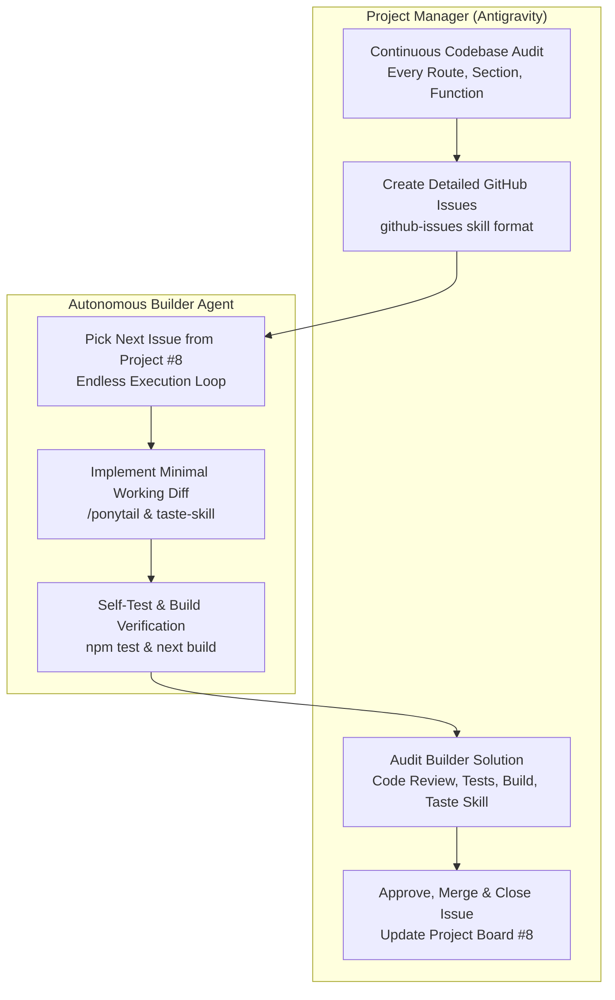

# 🏛️ Ayush-Devfolio: Full-Project Master Audit & Autonomous Issue Backlog

**Project:** `ayush-devfolio`  
**Manager Role:** Lead Systems Architect, Quality Gatekeeper & Repository Manager  
**Builder Target:** Autonomous Builder Agent Loop  
**GitHub Project Board:** `https://github.com/users/ayushtiwari18/projects/8/views/1`  
**Standards:** `/ponytail` (Pragmatic Minimal Diff) + `design-taste-frontend` (`tasteskill 2.5` Anti-Slop)  
**Date:** November 13, 2026  

---

## 📌 Section 1: Executive Architecture & Manager Mandate

As the Project Manager for `ayush-devfolio`, I oversee the complete codebase lifecycle across every route, section, API function, and user interaction. 

### The Manager-Builder Workflow

---

## 📋 Section 2: Complete Project Audit & Categorized Defect Catalog

### Area 1: In-Context Blog & Editorial Engine
* **Issue #1 (Bug):** Markdown articles render as unformatted raw `
` text in `BlogContent.js`.
  * *Affected:* [`src/components/blog/BlogContent.js`](file:///run/media/ayush5410/Ayush/Portfolio/ayush-devfolio/src/components/blog/BlogContent.js)
  * *Root Cause:* `BlogContent` assumes BlockNote JSON array; Markdown string causes `JSON.parse` fallback to single pre-wrap paragraph.
* **Issue #2 (Bug):** Table of Contents sidebar completely empty on Markdown articles.
  * *Affected:* [`src/components/blog/BlogSidebar.js`](file:///run/media/ayush5410/Ayush/Portfolio/ayush-devfolio/src/components/blog/BlogSidebar.js)
  * *Root Cause:* `extractHeadings` only traverses JSON blocks, returning `[]` for Markdown text.
* **Issue #3 (Feature):** Replace 576px modal drawer with unlocked in-context editor on `/blog/[slug]`.
  * *Affected:* [`src/app/blog/[slug]/page.js`](file:///run/media/ayush5410/Ayush/Portfolio/ayush-devfolio/src/app/blog/[slug]/page.js), [`src/components/blog/BlogFilterClient.js`](file:///run/media/ayush5410/Ayush/Portfolio/ayush-devfolio/src/components/blog/BlogFilterClient.js)
  * *Root Cause:* Long-form writing currently forced into narrow `InspectorDrawer` instead of dedicated on-page editorial canvas.

### Area 2: Global Layout & DOM Hierarchy
* **Issue #4 (Bug):** Nested `<main>` tags and 220px redundant top padding across all subpages.
  * *Affected:* [`src/components/layout/PublicShell.js`](file:///run/media/ayush5410/Ayush/Portfolio/ayush-devfolio/src/components/layout/PublicShell.js)
  * *Root Cause:* `PublicShell` wraps `{children}` in `<main className="pt-24 sm:pt-28">` while subpage templates (`/about`, `/blog`, `/projects`, `/events`, `/contact`) also define `<main className="pt-28 sm:pt-36">`.

### Area 3: Data Layer & Client Caching
* **Issue #5 (Bug):** Global fetch cache override forcing `revalidate: 60` on client-side mutations.
  * *Affected:* [`src/lib/supabase.js`](file:///run/media/ayush5410/Ayush/Portfolio/ayush-devfolio/src/lib/supabase.js)
  * *Root Cause:* Custom `fetch` polyfill injects Next.js ISR options globally into `supabase-js`, polluting client POST/PATCH queries with stale cache.

### Area 4: Forms & Telemetry Integration
* **Issue #6 (Bug):** Homepage `Contact.js` bypasses Server Action and Resend email alerts.
  * *Affected:* [`src/components/sections/Contact.js`](file:///run/media/ayush5410/Ayush/Portfolio/ayush-devfolio/src/components/sections/Contact.js), [`src/app/actions/contact.js`](file:///run/media/ayush5410/Ayush/Portfolio/ayush-devfolio/src/app/actions/contact.js)
  * *Root Cause:* Homepage form calls `supabase.from('contact_messages')` directly with no subject or email notification triggering, diverging from `/contact` page implementation.

### Area 5: Admin Authorization & HUD Context
* **Issue #7 (Bug):** Inconsistent admin auth: hardcoded `x-admin-secret` fallback vs Supabase JWT.
  * *Affected:* [`src/components/admin/inspectors/SkillsInspector.js`](file:///run/media/ayush5410/Ayush/Portfolio/ayush-devfolio/src/components/admin/inspectors/SkillsInspector.js), [`src/components/admin/inspectors/CodingStatsInspector.js`](file:///run/media/ayush5410/Ayush/Portfolio/ayush-devfolio/src/components/admin/inspectors/CodingStatsInspector.js), [`src/app/api/admin/skills/route.js`](file:///run/media/ayush5410/Ayush/Portfolio/ayush-devfolio/src/app/api/admin/skills/route.js)
  * *Root Cause:* API routes check `x-admin-secret` matching `mysecret123`, while Admin HUD uses real Supabase Auth sessions.
* **Issue #8 (Enhancement):** AdminDock HUD lacks context actions for slug routes (`/blog/[slug]` and `/projects/[slug]`).
  * *Affected:* [`src/components/admin/AdminDock.js`](file:///run/media/ayush5410/Ayush/Portfolio/ayush-devfolio/src/components/admin/AdminDock.js)
  * *Root Cause:* Route checks use strict equality (`pathname === '/blog'`), disabling context HUD triggers on dynamic child slugs.

### Area 6: Routing & Navigation
* **Issue #9 (Task):** Missing `/hackathons` route in global `NAV_LINKS` and legacy Admin button in Navbar.
  * *Affected:* [`src/lib/constants.js`](file:///run/media/ayush5410/Ayush/Portfolio/ayush-devfolio/src/lib/constants.js), [`src/components/layout/Navbar.js`](file:///run/media/ayush5410/Ayush/Portfolio/ayush-devfolio/src/components/layout/Navbar.js)
  * *Root Cause:* Hackathons page is orphaned from primary navigation, and Navbar links to `/admin/dashboard` instead of triggering the modern in-context HUD.

---

## 🚀 Section 3: Detailed GitHub Issue Specifications (Ready for Builder Agent)

Below are the exact structured specifications generated under the `github-issues` skill format.

---

### Issue 1: Fix Markdown publication rendering and code block styling in BlogContent
* **Type:** `Bug`
* **Labels:** `bug`, `high-priority`, `blog`
* **Target:** `src/components/blog/BlogContent.js`
* **Description:**
  Publications written in Markdown format render as an unstyled raw `
` element with `whitespace-pre-wrap` because `BlogContent.js` only parses BlockNote JSON arrays.
* **Steps to Reproduce:**
  1. Open `/blog/[slug]` for any post saved via `BlogInspector` (e.g. Markdown format).
  2. Inspect the article body.
  3. Notice headings, code blocks, lists, and tables render without HTML tags or syntax highlighting.
* **Expected Behavior:**
  Markdown strings should render with `ReactMarkdown`, syntax highlighting via `SyntaxHighlighter`, copy-code triggers, and anchor IDs on all headings. BlockNote JSON arrays must continue to render correctly.
* **Acceptance Criteria:**
  - [ ] Supports both Markdown string and legacy BlockNote JSON block content.
  - [ ] Code blocks render with syntax highlighting and tactile copy button.
  - [ ] Heading elements render semantic tags (`<h2>`, `<h3>`) with slugified `id` attributes.

---

### Issue 2: Parse Markdown headings for dynamic Table of Contents in BlogSidebar
* **Type:** `Bug`
* **Labels:** `bug`, `blog`
* **Target:** `src/components/blog/BlogSidebar.js`
* **Description:**
  `extractHeadings` in `BlogSidebar.js` only inspects BlockNote JSON arrays. For Markdown articles, it returns `[]`, causing the Table of Contents navigation to remain completely blank.
* **Steps to Reproduce:**
  1. Navigate to `/blog/[slug]`.
  2. Inspect the right sidebar sticky Table of Contents.
  3. Observe that no headings appear.
* **Expected Behavior:**
  `extractHeadings` must detect whether `content` is a string and use regex to parse `^## ` and `^### ` headings, generating matching slug IDs for the scroll-spy IntersectionObserver.
* **Acceptance Criteria:**
  - [ ] TOC populates headings for Markdown posts and BlockNote posts.
  - [ ] Smooth scrolling and active heading highlight function when clicking TOC links.

---

### Issue 3: Unlock in-context blog editor directly at `/blog/[slug]` and remove modal drawer
* **Type:** `Feature`
* **Labels:** `enhancement`, `blog`, `admin`, `high-priority`
* **Target:** `src/app/blog/[slug]/page.js`, `src/components/blog/BlogFilterClient.js`, `src/components/admin/DrawerHost.js`
* **Description:**
  Currently, blog editing is confined to a 576px wide `InspectorDrawer` modal. Long-form technical authoring in a sidebar drawer is cramped. Editing must unlock directly on the post's page at `/blog/[slug]`.
* **Proposed Solution:**
  1. On `/blog` catalog, clicking "Edit" on a card navigates to `/blog/[slug]?edit=true`.
  2. On `/blog/[slug]`, when Admin Edit Mode is active, provide an in-page editorial HUD:
     - Toggle between `[ Read View ]`, `[ In-Context Edit ]`, and `[ Split Preview ]`.
     - Full-width editing area (constrained to 720px reading measure or split screen).
     - Inline editable Title, Excerpt, Cover Image, and Tags.
     - Sticky persistence bar with Save, Discard, and Publish toggle.
* **Acceptance Criteria:**
  - [ ] Editing happens directly on `/blog/[slug]` with no modal drawer.
  - [ ] Save updates Supabase directly and revalidates page cache.
  - [ ] Card Edit button on `/blog` routes to `/blog/[slug]?edit=true`.

---

### Issue 4: Eliminate nested `<main>` landmark and 220px redundant top padding in PublicShell
* **Type:** `Bug`
* **Labels:** `bug`, `ui/ux`, `accessibility`
* **Target:** `src/components/layout/PublicShell.js`
* **Description:**
  `PublicShell` wraps `{children}` in a `<main id="main-content" className="pt-24 sm:pt-28">` element, but subpages (`/blog`, `/projects`, `/about`, `/events`, `/contact`) also define `<main className="pt-28 sm:pt-36">`. This causes W3C accessibility violations and over 220px of dead blank vertical space at the top of every page.
* **Expected Behavior:**
  `PublicShell` must render a neutral `
` and should not inject additional top padding when the child page provides its own padding.
* **Acceptance Criteria:**
  - [ ] No nested `<main>` tags in rendered DOM.
  - [ ] Top spacing between navbar and page headers matches Taste Skill standards across all breakpoints.

---

### Issue 5: Normalize Supabase global fetch polyfill to isolate mutation caching
* **Type:** `Bug`
* **Labels:** `bug`, `backend`, `cache`
* **Target:** `src/lib/supabase.js`
* **Description:**
  `global.fetch` in `src/lib/supabase.js` injects `next: { revalidate: 60 }` into every request. This causes client-side `POST`, `PATCH`, and `DELETE` requests to be improperly cached or rejected by the browser fetch standard, resulting in stale UI data after admin updates.
* **Expected Behavior:**
  Next.js caching options must only apply to server-side `GET` requests; client-side mutations must bypass Next.js cache.
* **Acceptance Criteria:**
  - [ ] Mutations (`insert`, `update`, `delete`) reflect immediately on the client.
  - [ ] Server-side read caching is preserved.

---

### Issue 6: Unify Contact form on Homepage to use Server Action and Resend email alerts
* **Type:** `Bug`
* **Labels:** `bug`, `contact`
* **Target:** `src/components/sections/Contact.js`, `src/app/actions/contact.js`
* **Description:**
  Homepage `Contact.js` calls `supabase.from('contact_messages')` directly via client anon key, bypassing the `submitContactForm` Server Action in `src/app/actions/contact.js`. Consequently, input validation is bypassed and email alerts via Resend never trigger.
* **Expected Behavior:**
  Homepage `Contact.js` should invoke `submitContactForm` or share the unified `ContactForm` component used on `/contact`.
* **Acceptance Criteria:**
  - [ ] Form submissions send notifications via Resend when configured.
  - [ ] Input validation is consistent between `/` and `/contact`.

---

### Issue 7: Unify Admin API authorization with Supabase JWT sessions
* **Type:** `Bug`
* **Labels:** `security`, `admin`
* **Target:** `src/app/api/admin/skills/route.js`, `src/app/api/admin/status/route.js`, `src/components/admin/inspectors/SkillsInspector.js`
* **Description:**
  `SkillsInspector` and `CodingStatsInspector` authenticate requests using an insecure `x-admin-secret` header that falls back to a hardcoded string `mysecret123`, while the rest of the application uses Supabase Auth sessions.
* **Expected Behavior:**
  Admin API routes should verify the Supabase Auth session JWT token, ensuring unified session-based security across all admin features.
* **Acceptance Criteria:**
  - [ ] Hardcoded secret strings removed from client inspectors.
  - [ ] API routes verify authenticated admin session.

---

### Issue 8: Add dynamic slug route awareness to AdminDock HUD
* **Type:** `Enhancement`
* **Labels:** `enhancement`, `admin`, `ui/ux`
* **Target:** `src/components/admin/AdminDock.js`
* **Description:**
  `AdminDock` only checks exact matches (`pathname === '/blog'`, `pathname === '/projects'`). When viewing `/blog/[slug]` or `/projects/[slug]`, the dock disables contextual buttons, leaving the admin without quick controls on individual items.
* **Expected Behavior:**
  When on `/blog/[slug]`, `AdminDock` should display `[ Edit Post ]` and `[ Toggle Published ]`. When on `/projects/[slug]`, display `[ Edit Case Study ]`.
* **Acceptance Criteria:**
  - [ ] Dock shows contextual controls on `/blog/[slug]`.
  - [ ] Dock shows contextual controls on `/projects/[slug]`.
