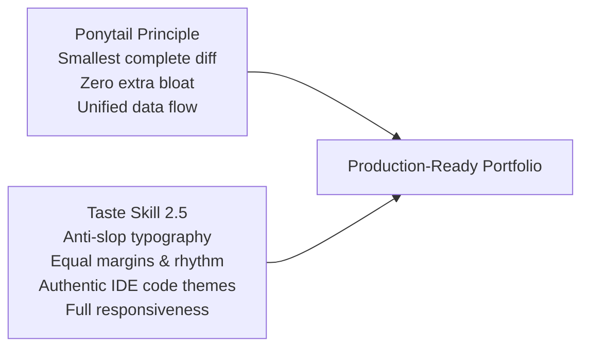
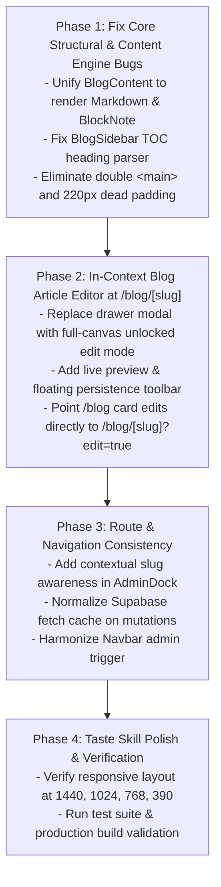

# 📋 Comprehensive Audit & Order Report: In-Context Admin & UX Overhaul

**Repository:** `ayush-devfolio`  
**Current Active Branch:** `feat/in-context-admin` (53 changed files, +9,482 lines vs `main`)  
**Evaluation Standard:** `/ponytail` (Pragmatic minimal diff & anti-bloat) + `design-taste-frontend` (`tasteskill 2.5`)  
**Date:** November 13, 2026  

---

## 📌 Executive Summary

All 23 Jest test suites (50 tests) pass, and `next build` compiles successfully (72 static/dynamic pages). However, a deep code and UX audit reveals significant architectural disconnects, broken rendering paths for markdown publications, double-wrapped layout containers causing excessive spacing, and a flawed editing UX where long-form writing is unnaturally crammed into a 576px modal drawer.

This report documents all findings to a **massive extent**, diagnoses root causes across files and routes, and presents an actionable, step-by-step roadmap to unlock in-context editing directly at `/blog/[slug]`.

---

## 🔍 Section 1: Massive Extent Audit Findings

### 🔴 1. Broken Content Engine: Markdown vs BlockNote Dualism
* **Affected Files:**
  * [`src/components/blog/BlogContent.js`](file:///run/media/ayush5410/Ayush/Portfolio/ayush-devfolio/src/components/blog/BlogContent.js)
  * [`src/components/blog/BlogSidebar.js`](file:///run/media/ayush5410/Ayush/Portfolio/ayush-devfolio/src/components/blog/BlogSidebar.js)
  * [`src/components/admin/inspectors/BlogInspector.js`](file:///run/media/ayush5410/Ayush/Portfolio/ayush-devfolio/src/components/admin/inspectors/BlogInspector.js)
  * [`src/app/blog/[slug]/page.js`](file:///run/media/ayush5410/Ayush/Portfolio/ayush-devfolio/src/app/blog/[slug]/page.js)
* **Root Cause & Impact:**
  1. **Unformatted Markdown Rendering:** `BlogInspector` writes posts as standard Markdown strings (`# Title`, ```` ```language ````, `- list`). However, [`BlogContent.js`](file:///run/media/ayush5410/Ayush/Portfolio/ayush-devfolio/src/components/blog/BlogContent.js#L427-L448) was authored to parse BlockNote JSON array blocks. When encountering a Markdown string, `JSON.parse` throws, triggering a rudimentary fallback:
     ```javascript
     <div className="prose prose-invert prose-lg max-w-none">
       <p className="text-gray-200 leading-relaxed whitespace-pre-wrap">{content}</p>
     </div>
     ```
     Headings, code syntax highlighting, tables, callouts, and lists are completely stripped of rich formatting and rendered as raw, unstyled text.
  2. **Broken Table of Contents (TOC):** [`BlogSidebar.js`](file:///run/media/ayush5410/Ayush/Portfolio/ayush-devfolio/src/components/blog/BlogSidebar.js#L9-L32) extracts headings strictly by parsing JSON blocks (`block.type === 'heading'`). On any markdown post, it returns an empty array `[]`, rendering the TOC sidebar completely blank.

---

### 🔴 2. Double `<main>` Landmark & Excessive Top Padding
* **Affected Files:**
  * [`src/components/layout/PublicShell.js`](file:///run/media/ayush5410/Ayush/Portfolio/ayush-devfolio/src/components/layout/PublicShell.js#L29-L34)
  * All subpages: [`src/app/blog/page.js`](file:///run/media/ayush5410/Ayush/Portfolio/ayush-devfolio/src/app/blog/page.js#L49), [`src/app/blog/[slug]/page.js`](file:///run/media/ayush5410/Ayush/Portfolio/ayush-devfolio/src/app/blog/[slug]/page.js#L162), [`src/app/projects/page.js`](file:///run/media/ayush5410/Ayush/Portfolio/ayush-devfolio/src/app/projects/page.js#L42), [`src/app/projects/[slug]/page.js`](file:///run/media/ayush5410/Ayush/Portfolio/ayush-devfolio/src/app/projects/[slug]/page.js#L110), [`src/app/about/page.js`](file:///run/media/ayush5410/Ayush/Portfolio/ayush-devfolio/src/app/about/page.js#L87), [`src/app/contact/page.js`](file:///run/media/ayush5410/Ayush/Portfolio/ayush-devfolio/src/app/contact/page.js#L61)
* **Root Cause & Impact:**
  * In `PublicShell.js`:
    ```jsx
    <main id="main-content" className={!isAdminRoute ? (isHome ? 'relative z-10' : 'pt-24 sm:pt-28 relative z-10') : ''}>
      {children}
    </main>
    ```
  * But each individual subpage template also renders `<main className="min-h-screen pt-28 sm:pt-36 ...">`.
  * **Violations:**
    1. **W3C / Accessibility Violation:** Nested `<main>` tags violate HTML5 specifications.
    2. **Excessive Vertical Whitespace:** Subpages accumulate `pt-24 sm:pt-28` + `pt-28 sm:pt-36` (over 220px+ of dead empty vertical space between navbar and page headers).

---

### 🔴 3. Admin Blog Editing UX: Modal Drawer vs In-Context `/blog/[slug]`
* **Affected Files:**
  * [`src/components/blog/BlogFilterClient.js`](file:///run/media/ayush5410/Ayush/Portfolio/ayush-devfolio/src/components/blog/BlogFilterClient.js#L87-L95)
  * [`src/components/admin/DrawerHost.js`](file:///run/media/ayush5410/Ayush/Portfolio/ayush-devfolio/src/components/admin/DrawerHost.js#L46-L51)
  * [`src/components/admin/inspectors/BlogInspector.js`](file:///run/media/ayush5410/Ayush/Portfolio/ayush-devfolio/src/components/admin/inspectors/BlogInspector.js)
  * [`src/app/blog/[slug]/page.js`](file:///run/media/ayush5410/Ayush/Portfolio/ayush-devfolio/src/app/blog/[slug]/page.js#L223-L227)
* **Problem:**
  * On `/blog`, clicking the card edit button triggers `openDrawer('blog-edit', post)`.
  * On `/blog/[slug]`, hovering triggers an `EditableSection` button that opens `BlogInspector` inside `InspectorDrawer`.
  * Writing, formatting, and proofreading technical documentation in a narrow 576px (`max-w-xl`) sidebar drawer is counter-intuitive and cramped.
* **Target Solution (User Request):**
  * Editing must unlock **directly on the individual post's route** (`/blog/[slug]`).
  * On the catalog page (`/blog`), the card edit action should simply navigate directly to `/blog/[slug]?edit=true`.
  * When visiting `/blog/[slug]` in Admin Edit Mode, the page itself unlocks a full-width editorial workspace:
    * In-context editing of Title, Excerpt, Cover Image, and Metadata pills.
    * Full reading measure markdown editor with split-screen/preview toggle.
    * Real-time TOC preview and reading-time recalculation.
    * Floating action bar (Save, Publish/Draft toggle, Revert, Preview).

---

### 🟡 4. Supabase Client Mutation Caching Conflict
* **Affected File:** [`src/lib/supabase.js`](file:///run/media/ayush5410/Ayush/Portfolio/ayush-devfolio/src/lib/supabase.js#L33-L42)
* **Problem:**
  * `global.fetch` was overridden to inject `next: { revalidate: 60 }` globally on all requests.
  * While beneficial for public reads, forcing Next.js ISR revalidation options onto client-side `POST`, `PATCH`, and `DELETE` requests causes stale UI data after in-context saves until cache expiration.

---

### 🟡 5. Routing & Navigation Inconsistencies
* **Affected Files:**
  * [`src/lib/constants.js`](file:///run/media/ayush5410/Ayush/Portfolio/ayush-devfolio/src/lib/constants.js#L128-L150)
  * [`src/components/admin/AdminDock.js`](file:///run/media/ayush5410/Ayush/Portfolio/ayush-devfolio/src/components/admin/AdminDock.js#L186-L207)
  * [`src/components/layout/Navbar.js`](file:///run/media/ayush5410/Ayush/Portfolio/ayush-devfolio/src/components/layout/Navbar.js#L176-L184)
* **Problems:**
  * `/hackathons` exists with full page and services, but is missing from `NAV_LINKS` and sitemap metadata.
  * In `AdminDock.js`, `isBlog` is checked with `pathname === '/blog'`, which evaluates to `false` on `/blog/[slug]`. Thus, the dock offers no contextual quick-actions while on an article page.
  * Navbar contains an "Admin" badge linking to the legacy `/admin/dashboard` route instead of triggering the modern in-place HUD.

---

## 🎯 Section 2: Ponytail & Taste Skill Alignment



1. **Ponytail Rule (The Best Code is Code Never Written):**
   * Do NOT add bloated new third-party CMS libraries or complex WYSIWYG dependencies.
   * Reuse the existing `ReactMarkdown` + `rehype-slug` + `remark-gfm` + `react-syntax-highlighter` ecosystem already installed in `package.json`.
   * Unify `BlogContent.js` so it cleanly handles both legacy BlockNote JSON and Markdown without duplicating render trees.
2. **Taste Skill Frontend Standard:**
   * Typography: Clash Display for headers, Inter for long-form reading, JetBrains Mono for telemetry/code.
   * Reading Measure: Strictly constrained to `max-w-[720px]` (65–75 chars/line) with `leading-[1.8]` line-height.
   * Equal margins across breakpoints: 1440px desktop, 1024px tablet landscape, 768px tablet, 390px mobile.

---

## 🗺️ Section 3: Step-by-Step Execution Roadmap



### Phase 1: Fix Core Structural & Content Engine Bugs
1. Upgrade [`BlogContent.js`](file:///run/media/ayush5410/Ayush/Portfolio/ayush-devfolio/src/components/blog/BlogContent.js) to detect whether content is Markdown string or BlockNote JSON:
   * If Markdown: render with `ReactMarkdown`, custom IDE syntax highlighter code blocks, copy button, and slugified heading anchors.
   * If BlockNote: preserve existing block renderer.
2. Upgrade [`BlogSidebar.js`](file:///run/media/ayush5410/Ayush/Portfolio/ayush-devfolio/src/components/blog/BlogSidebar.js) `extractHeadings` to parse Markdown headings (`##`, `###`) in addition to JSON blocks so Table of Contents functions seamlessly on all posts.
3. Fix [`PublicShell.js`](file:///run/media/ayush5410/Ayush/Portfolio/ayush-devfolio/src/components/layout/PublicShell.js) so it renders a non-`<main>` container (`<div id="main-shell">`) and strips redundant `pt-24 sm:pt-28` padding when pages supply their own top spacing.

### Phase 2: Unlocked In-Context Blog Editor at `/blog/[slug]`
1. On [`/blog/[slug]/page.js`](file:///run/media/ayush5410/Ayush/Portfolio/ayush-devfolio/src/app/blog/[slug]/page.js):
   * When `editMode` is active, unlock the article directly on-page rather than opening the cramped 576px `InspectorDrawer`.
   * Provide a distraction-free toolbar at top of the article:
     * Toggle: `[ Read Mode ]` / `[ In-Context Edit ]` / `[ Split Preview ]`.
     * Live metrics: Word count, calculated read-time, published/draft status toggle.
     * Actions: Save Changes (with keyboard shortcut `Cmd/Ctrl+S`), Discard, Delete.
   * Editable inline fields for Title, Excerpt, Cover Image URL, Tags, and Series.
2. In [`BlogFilterClient.js`](file:///run/media/ayush5410/Ayush/Portfolio/ayush-devfolio/src/components/blog/BlogFilterClient.js):
   * Clicking "Edit" on a card navigates directly to `/blog/[slug]?edit=true`, focusing the user immediately on the content.

### Phase 3: Route & Navigation Hardening
1. In [`AdminDock.js`](file:///run/media/ayush5410/Ayush/Portfolio/ayush-devfolio/src/components/admin/AdminDock.js):
   * Add slug route detection: When on `/blog/[slug]`, show quick actions: `[ Edit Article ]`, `[ Toggle Published ]`, `[ View All Posts ]`.
2. In [`src/lib/supabase.js`](file:///run/media/ayush5410/Ayush/Portfolio/ayush-devfolio/src/lib/supabase.js):
   * Only apply `next: { revalidate: 60 }` to `GET` requests on the server; never force caching on mutations or client queries.

### Phase 4: Taste Skill Polish & Verification Gate
1. Test visual rendering across standard viewports (1440px desktop, 1024px tablet landscape, 768px tablet, 390px mobile).
2. Execute full test suite (`npm test`) and production build (`npm run build`).
